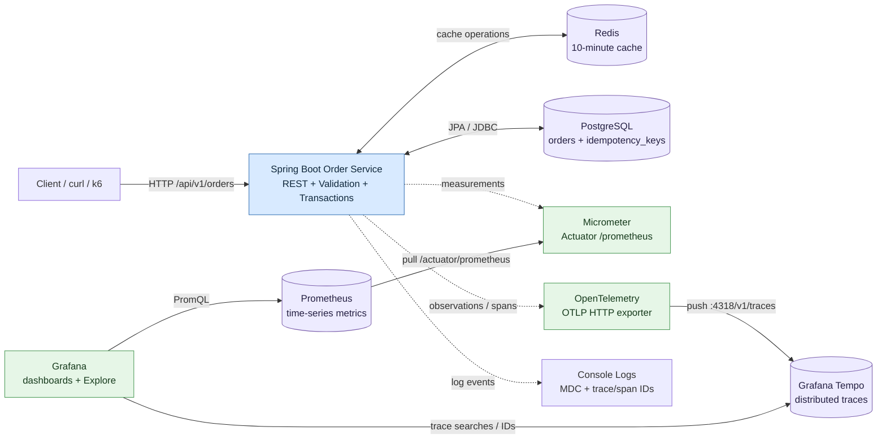
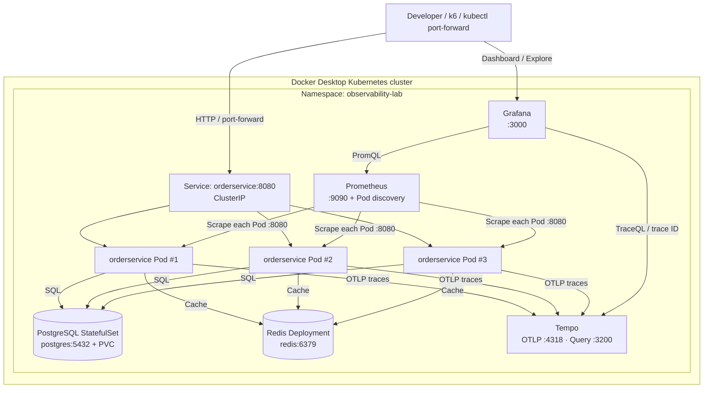
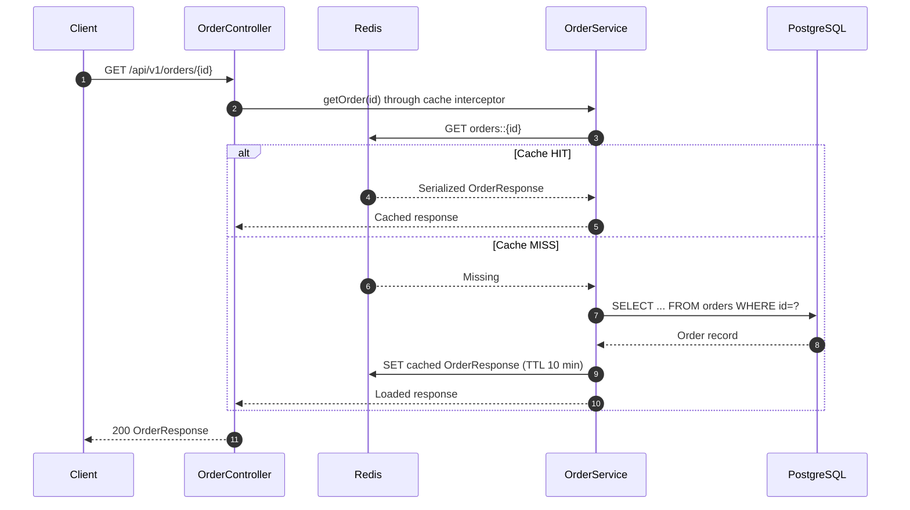
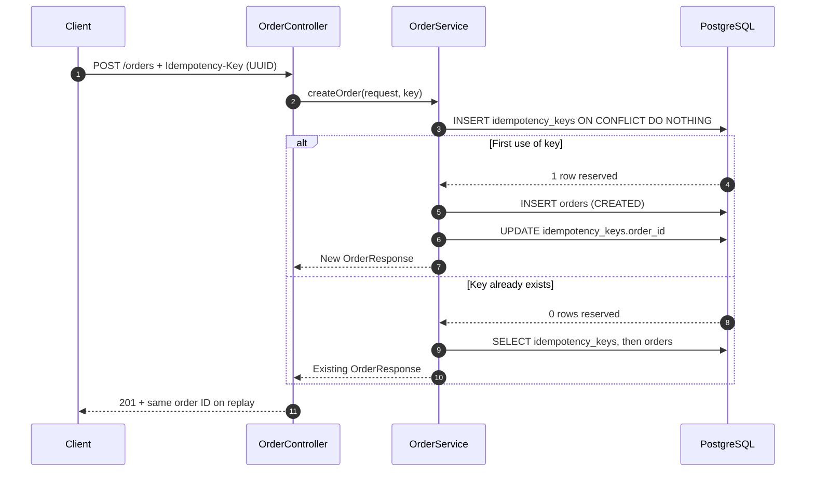
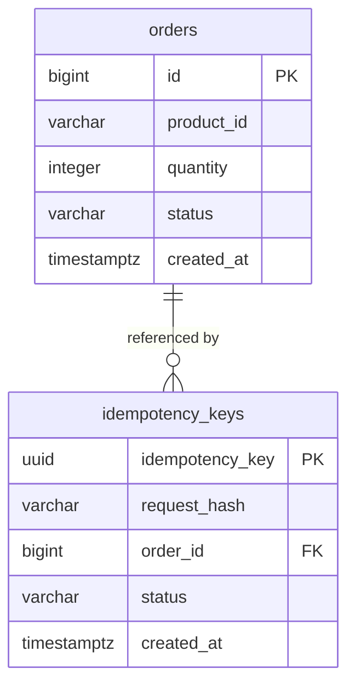
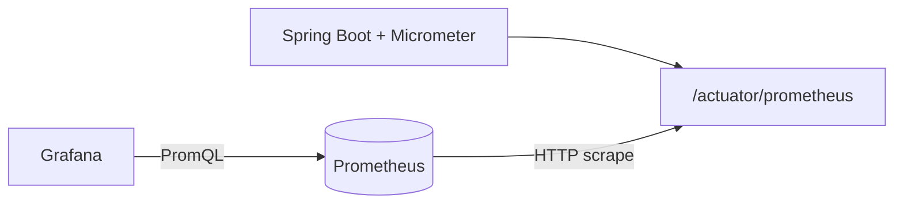
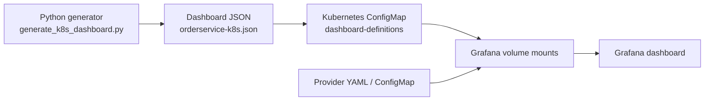

# Order Service — End-to-End Observability & Kubernetes Lab

<p align="center">
  <strong>Build an observable Spring Boot service, measure its behavior, and operate it on Kubernetes.</strong>
</p>

<p align="center">
  <a href="#quick-start-docker-compose"><strong>Quick Start</strong></a> ·
  <a href="#system-architecture"><strong>Architecture</strong></a> ·
  <a href="#kubernetes-deployment"><strong>Kubernetes</strong></a> ·
  <a href="#observability-deep-dive"><strong>Observability</strong></a> ·
  <a href="#load-testing-and-capacity"><strong>Load Tests</strong></a> ·
  <a href="#troubleshooting"><strong>Troubleshooting</strong></a>
</p>


> [!IMPORTANT]
> **Current repository state:** The `main` branch includes the complete Spring Boot application, Docker Compose stack, **all five Kubernetes manifests**, Prometheus and Tempo configuration, the Grafana dashboard generator, the generated dashboard JSON, and dashboard provisioning YAML. A fresh clone contains the source files needed for both deployment paths. **One bootstrap step is still required:** generate the `grafana-dashboard-provider` and `grafana-dashboard-definitions` ConfigMaps from their committed files before applying `k8s/grafana.yaml`. The application image and database/Grafana Secrets must also be created locally; a one-command Kustomize/Helm installer is not yet included. See [Kubernetes deployment](#kubernetes-deployment).

---

## Contents

1. [What is this project?](#what-is-this-project)
2. [Learning goals and capabilities](#learning-goals-and-capabilities)
3. [System architecture](#system-architecture)
4. [Technology stack — what each tool does](#technology-stack--what-each-tool-does)
5. [Domain model and API contracts](#domain-model-and-api-contracts)
6. [Core application design](#core-application-design)
7. [Observability deep dive](#observability-deep-dive)
8. [Repository structure](#repository-structure)
9. [Prerequisites](#prerequisites)
10. [Quick Start — Docker Compose](#quick-start-docker-compose)
11. [Try the API](#try-the-api)
12. [Metrics, dashboards, and traces](#metrics-dashboards-and-traces)
13. [Kubernetes deployment](#kubernetes-deployment)
14. [Grafana Dashboard as Code](#grafana-dashboard-as-code)
15. [Load testing and capacity](#load-testing-and-capacity)
16. [Testing and CI](#testing-and-ci)
17. [Failure experiments and operational behavior](#failure-experiments-and-operational-behavior)
18. [Configuration reference](#configuration-reference)
19. [Troubleshooting](#troubleshooting)
20. [Design decisions, limitations, and next steps](#design-decisions-limitations-and-next-steps)
21. [Glossary and learning resources](#glossary-and-learning-resources)

---

## What is this project?

**Order Service** is an intentionally small order-management API wrapped in an end-to-end observability and operations environment. It is not intended to be a commerce product. The **system behavior**—cache hits versus misses, concurrent requests, latency, failed dependencies, request traces, scaling, and recovery—is the product of this lab.

The application can:

- Create an order using a required, UUID-formatted `Idempotency-Key`.
- Retrieve an order, using Redis as a cache-aside read-through layer around PostgreSQL.
- Update an order's status and evict its cached representation.
- Persist data in PostgreSQL, with schema changes managed by Flyway.
- Publish JVM, web, cache, database-pool, and custom business metrics using Micrometer.
- Expose Prometheus-compatible metrics through Spring Boot Actuator.
- Generate OpenTelemetry traces and export them over OTLP/HTTP to Grafana Tempo.
- Attach correlation IDs and trace/span IDs to application logs.
- Run locally alongside open-source observability services using Docker Compose.
- Run as multiple Spring Boot replicas on local Kubernetes, with Pods, Services, probes, ConfigMaps, Secrets, and persistent storage.
- Generate repeatable load with k6 and observe how the system responds.

### Mental model

| Question | Best first signal | Tool |
| --- | --- | --- |
| Is the application up? | Health / availability | Actuator, Kubernetes, Prometheus |
| How many requests are arriving? | Request rate | Prometheus + Grafana |
| How slow are requests? | Latency histogram / percentiles | Micrometer + Prometheus |
| Are requests failing? | Status-code metrics and logs | Prometheus, Grafana, application logs |
| **Why** is a particular request slow? | Per-request spans | OpenTelemetry + Tempo |
| Did a GET access PostgreSQL? | `order.database.read` child observation | Tempo |
| Was the GET served from Redis? | Cache hit/miss metric; absence of DB-read span | Micrometer + Tempo |
| Which request produced this log? | Correlation ID and trace ID | SLF4J MDC / trace context |
| What happens when a Pod dies? | Replica reconciliation | Kubernetes |
| Can three replicas handle more traffic than one? | Controlled load and per-Pod telemetry | k6, Prometheus, Grafana |

### What this is **not**

This is a learning/reference environment, **not** a hardened production platform. It does not currently ship authentication/authorization, a centralized log backend, HA PostgreSQL/Redis/Tempo/Prometheus, network policies, TLS ingress, autoscaling, or a fully automated Kubernetes delivery pipeline.

---

## Learning goals and capabilities

The lab spans several layers that are often discussed separately in system design interviews:

| Layer | What you practice | Key implementation |
| --- | --- | --- |
| API design | Contracts, validation, idempotency, error codes | Spring MVC controller, DTOs |
| Data consistency | Atomic writes, unique constraints, replay handling | PostgreSQL, JPA, transaction boundaries |
| Caching | Cache-aside, TTL, invalidation, failure modes | Redis, `@Cacheable`, `@CacheEvict` |
| Metrics | Counters, timers, histograms, rates, cardinality | Micrometer, Prometheus, PromQL |
| Tracing | Spans, parent/child hierarchy, trace context | Micrometer Observation, OpenTelemetry, Tempo |
| Logs | Structured fields, correlation ID, trace/span ID | SLF4J MDC, Spring logging |
| Visualization | RED metrics, JVM metrics, per-Pod panels | Grafana |
| Testing | Integration, concurrency, containers | JUnit, Testcontainers |
| Performance | RPS, VUs, open-loop load, P95/P99, bottlenecks | k6 |
| Operations | Scheduling, readiness, replacement, discovery | Docker Desktop Kubernetes |
| Reproducibility | Container images, manifests, configuration as code | Dockerfile, Compose, Kubernetes YAML, Grafana JSON |

---

## System architecture

### 1. Application and observability — logical view



> **Two different data flows:** Prometheus **pulls** metrics from the application's Actuator endpoint. The Spring Boot OpenTelemetry integration **pushes** traces to Tempo. Grafana **queries** these backends; Grafana is not the primary metric or trace storage system.

### 2. Kubernetes — physical deployment

This is the topology exercised locally and codified in the committed `k8s/` manifests on GitHub `main`.



**Kubernetes objects in use**

| Construct | Why it exists here | Example |
| --- | --- | --- |
| **Namespace** | Logical grouping and resource scope | `observability-lab` |
| **Deployment** | Desired replica count and Pod self-healing | `orderservice` (3 replicas) |
| **ReplicaSet** | Keeps the requested number of Pods alive | Created by Deployment |
| **Pod** | One running application instance | `orderservice-...` |
| **Service / ClusterIP** | Stable service name despite Pod churn | `orderservice:8080` |
| **StatefulSet** | Stable identity/storage pattern for PostgreSQL | `postgres-0` |
| **PVC** | Retains database data beyond Pod recreation | `postgres-data-postgres-0` |
| **ConfigMap** | Nonsecret configuration and Grafana dashboard definitions | `grafana-datasources` |
| **Secret** | Injects DB and Grafana credentials | `postgres-credentials` |
| **Readiness probe** | Prevents traffic to Pods that aren't ready | Actuator readiness endpoint |
| **Liveness probe** | Helps restart genuinely stuck application containers | Actuator liveness endpoint |
| **Startup probe** | Gives Spring Boot time to initialize | Actuator health |
| **ServiceAccount + RBAC** | Allows Prometheus to discover namespace Pods | `prometheus-pod-reader` |

**Important networking nuance:** a Kubernetes Service routes connections, not necessarily individual HTTP requests uniformly. `kubectl port-forward svc/orderservice` can attach to a single selected Pod; it is **not** a valid load-balancing test by itself.

### 3. Request/response and cache sequence



The cache interceptor can return a hit **without entering the `@Cacheable` method body**. As a result, the custom `order.database.read` observation is expected only when the database read occurs.

### 4. Idempotent order creation



The reservation and order write happen in the same Spring transaction. PostgreSQL's primary-key constraint and `ON CONFLICT DO NOTHING` arbitrate concurrent claims to the same key.

**Current limitation:** the code reserves the key with request hash value `"DEFERRED"`; it does **not** yet compute/verify a canonical request-body hash. Reusing the same key with a *different* request body can replay the original order rather than reject it. This is sufficient for the lab's basic duplicate-write experiment, but should be fixed before production use.

### 5. Persistence model



Flyway migrations:

- `V1__create_orders_table.sql`: `orders` table, positive quantity check, index on `created_at`.
- `V2__create_idempotency_keys_table.sql`: UUID-primary-key reservation table with nullable FK `order_id`.

---

## Technology stack — what each tool does

### Application and data

| Technology | Role in this project | Why use it / what you learn |
| --- | --- | --- |
| **Java 21** | Application runtime | Modern JVM, concurrency and performance observability |
| **Spring Boot 4.1.2** | Application framework | REST, auto-configuration, DI, Actuator, validation |
| **Spring MVC** | HTTP layer | Controllers and API contracts |
| **Spring Data JPA / Hibernate** | Persistence abstraction | ORM, transactions, repositories |
| **HikariCP** | JDBC connection pool | Connection-pool limits, contention, connection telemetry |
| **PostgreSQL 17** | System of record | Relational schema, transactions, uniqueness, constraints |
| **Flyway** | Schema migrations | Predictable, ordered database evolution |
| **Redis 7** | Shared cache | Faster repeated reads, TTL, invalidation, failure modes |
| **Spring Cache** | Caching abstraction | `@Cacheable`, `@CacheEvict`, transactional cache interaction |
| **pgAdmin** | PostgreSQL browser | Inspect tables and queries |
| **Redis Insight** | Redis browser | Inspect keys, TTLs, and cache serialization |

### Observability and performance

| Technology | Classification | What it does **here** | Important distinction |
| --- | --- | --- | --- |
| **Spring Boot Actuator** | Application instrumentation endpoints | `/actuator/health`, `/actuator/metrics`, `/actuator/prometheus` | Exposes health and measurements; not the metrics database |
| **Micrometer** | Metrics + observation instrumentation | HTTP metrics, custom counters, cache metrics, timed observations | JVM/application instrumentation abstraction |
| **Prometheus** | Time-series backend | Periodically scrapes metrics; evaluates PromQL | Pulls metrics and stores numeric time series |
| **Grafana** | Visualization and query UI | Dashboards, per-Pod charts, Explore, data-source integration | Queries backends; not a replacement for Prometheus or Tempo |
| **OpenTelemetry (OTel)** | Open, vendor-neutral telemetry framework | Instrumentation/tracing/export through Spring Boot starter | **Not itself** a trace database or dashboard |
| **OTLP/HTTP** | Telemetry transport protocol | Pushes spans to Tempo at `/v1/traces` | Protocol, not storage |
| **Grafana Tempo** | Trace backend | Ingests, stores, and retrieves traces | Used for *request-level causal timelines* |
| **SLF4J MDC** | Log-context mechanism | Adds `correlationId` to log lines; tracing adds trace/span IDs | Context decoration, not centralized log aggregation |
| **k6** | Load generator | Constant-VU and constant-arrival-rate experiments | Measures client-observed performance |
| **Testcontainers** | Integration-test infrastructure | Starts real PostgreSQL and Redis for tests | Different from running the application using Compose |
| **Docker Compose** | Local orchestration | Runs dependencies and telemetry services | Single-host development stack |
| **Kubernetes** | Workload orchestration | Pods, services, replicas, health checks, self-healing | Does not automatically make every dependency HA |

**Why use both Micrometer and OpenTelemetry?**

The code uses `MeterRegistry` for metrics, `ObservationRegistry` for named application operations, and the Spring Boot OpenTelemetry starter to turn eligible observations into traces/spans. This bridges **aggregate measurements** (e.g., RPS) and **single-request details** (e.g., `order.database.read` duration).

**Why both Prometheus and Tempo?**

- **Prometheus answers**: “Over the last five minutes, what was the P95 latency?”
- **Tempo answers**: “For *this exact slow request*, which operation consumed the time?”
- **Logs answer**: “What event or error did the application record at that time?”
- **Grafana provides** a shared UI for metrics and traces.

**Why no OpenTelemetry Collector yet?** This baseline exports directly from the Spring Boot app to Tempo. A Collector or Grafana Alloy could later add batching, retries, sampling, policy controls, and routing independently of the application.

**Open-source references:** [OpenTelemetry](https://opentelemetry.io/docs/), [Prometheus](https://prometheus.io/docs/), [Grafana OSS](https://grafana.com/oss/grafana/), [Tempo](https://grafana.com/docs/tempo/latest/), [k6](https://grafana.com/docs/k6/latest/), [Kubernetes](https://kubernetes.io/docs/home/).

---

## Domain model and API contracts

Base URL:

```text
http://localhost:8080/api/v1/orders
```

For Kubernetes port-forward examples in this guide, use `http://localhost:8081/api/v1/orders`.

### API summary

| Method | Endpoint | Body | Result | Notes |
| --- | --- | --- | --- | --- |
| `POST` | `/api/v1/orders` | `{"productId":"book","quantity":2}` | `201 Created` | **Requires** UUID `Idempotency-Key`; response has `Location` |
| `GET` | `/api/v1/orders/{orderId}` | — | `200 OK` | Redis-backed cached read; `404` if absent |
| `PATCH` | `/api/v1/orders/{orderId}/status` | `{"status":"SHIPPED"}` | `200 OK` | Persists status, invalidates cache |
| `GET` | `/actuator/health` | — | Health JSON | Health / dependency visibility |
| `GET` | `/actuator/metrics` | — | Metrics metadata | Micrometer metric names |
| `GET` | `/actuator/prometheus` | — | Prometheus exposition | Scrape target |

### Create request

```http
POST /api/v1/orders HTTP/1.1
Content-Type: application/json
Idempotency-Key: 8b0f9c2d-7a2f-4a75-9892-95ebc35ef071

{
  "productId": "book",
  "quantity": 2
}
```

Example response shape (**illustrative ID and timestamp**):

```http
HTTP/1.1 201 Created
Location: /api/v1/orders/42
X-Correlation-ID: 3e721693-858b-4c0b-88e9-1ff2f17e023e

{
  "id": 42,
  "productId": "book",
  "quantity": 2,
  "status": "CREATED",
  "createdAt": "2026-10-24T13:40:00Z"
}
```

The code validates:

- `productId`: must not be blank.
- `quantity`: required and must be **at least 1**.
- `status` on PATCH: must not be blank.
- `Idempotency-Key`: required and must parse as a UUID.

Invalid payloads return `400`; missing orders return `404` using Spring `ProblemDetail`. Unhandled dependency failures can return `500`. No authentication is implemented.

### Correlation IDs

Each incoming request can supply:

```http
X-Correlation-ID: <UUID>
```

The `CorrelationIdFilter` accepts a valid UUID; if missing or malformed, it generates a new one, adds it to both the response header and SLF4J MDC, and cleans MDC up after the request.

**Correlation ID** is an application/request tracking value. **Trace ID** identifies the OpenTelemetry trace. They are related but **not the same identifier**.

---

## Core application design

### Request handling

- `OrderController`: HTTP validation, observations, business counters, responses.
- `OrderService`: order creation/replay, read caching, DB lookup, status updates.
- `OrderRepository` / `IdempotencyRepository`: JPA and native PostgreSQL conflict-safe insert.
- `OrderEntity` / `IdempotencyEntity`: database mappings.
- DTO records: `CreateOrderRequest`, `OrderResponse`, `UpdateOrderStatusRequest`.
- `GlobalExceptionHandler`: 400 and 404 `ProblemDetail` responses.
- `CorrelationIdFilter`: request correlation and MDC cleanup.
- `RedisCacheConfig`: JSON serialization, TTL, cache-manager statistics.

### Cache-aside behavior

The relevant implementation is:

```java
@Cacheable(cacheNames = "orders", key = "#orderId")
@Transactional(readOnly = true)
public OrderResponse getOrder(Long orderId) { ... }
```

```java
@Transactional
@CacheEvict(cacheNames = "orders", key = "#orderId")
public OrderResponse updateOrderStatus(Long orderId, String status) { ... }
```

The cache key is typically `orders::<orderId>`. Values are serialized `OrderResponse` objects using the configured Jackson JSON serializer. TTL is **10 minutes**; null results are not cached. The configured Redis cache manager is transaction-aware and has statistics enabled.

**Consequences:**

1. A fresh GET usually misses Redis and reads PostgreSQL.
2. A repeated GET can be answered from Redis.
3. A successful status update invalidates the key.
4. The next GET reloads the new status from PostgreSQL.
5. After 10 minutes, entries expire and the database is queried again.
6. If Redis is unavailable, this implementation does **not** provide a guaranteed DB fallback; experiments observed HTTP 500s for affected GET requests. See [Failure experiments](#failure-experiments-and-operational-behavior).

### Transactional idempotency

`IdempotencyRepository.reserveKey` uses native SQL:

```sql
INSERT INTO idempotency_keys (idempotency_key, request_hash, status)
VALUES (:key, :requestHash, 'COMPLETED')
ON CONFLICT (idempotency_key) DO NOTHING;
```

The service checks the affected row count to decide whether to create a new order or retrieve the previous one. This makes the key claim atomic at the database level. A duplicate POST currently returns **201 Created** again with the original order representation.

**Follow-up hardening:** hash normalized request parameters, reject mismatched replay bodies, improve handling of incomplete/failed reservations, and define idempotency-key retention and replay expiry.

---

## Observability deep dive

### The three signals

| Signal | Data model | Strength | Example |
| --- | --- | --- | --- |
| **Metrics** | Numeric time series indexed by labels | Trends, baselines, alert thresholds | `http_server_requests_seconds_count` |
| **Traces** | Spans arranged in request causality/timing tree | Explaining individual request paths | `order.get` → `order.database.read` |
| **Logs** | Event records with contextual fields | Errors, important state transitions | `event=order.create.completed` |

OpenTelemetry standardizes telemetry instrumentation and transport. The lab uses Prometheus as its **metrics backend** and Tempo as its **trace backend**. Application logs currently remain in container/terminal output; **Loki/Alloy are not deployed** in the current repository.

### Metrics: Actuator → Micrometer → Prometheus



**Key code/configuration**

- `micrometer-registry-prometheus` in `pom.xml`.
- `management.endpoints.web.exposure.include: health,info,metrics,prometheus`.
- `management.metrics.distribution.percentiles-histogram.http.server.requests: true`.
- `meterRegistry.counter("orders.create.completed").increment()`.
- `meterRegistry.counter("orders.status.update.completed").increment()`.
- `RedisCacheManager.enableStatistics()`.

**Prometheus metrics you can explore**

| Metric family | Interpretation |
| --- | --- |
| `up` | Did Prometheus successfully scrape this target? |
| `http_server_requests_seconds_count` | Number of recorded HTTP requests |
| `http_server_requests_seconds_bucket` | HTTP duration histogram buckets, when enabled |
| `http_server_requests_seconds_sum` | Sum of request durations |
| `orders_create_completed_total` | Custom completed-create counter |
| `orders_status_update_completed_total` | Custom status-update counter |
| `cache_gets_total` | Cache get results (hit/miss labels, when bound) |
| `jvm_memory_used_bytes` | JVM memory in use |
| `jvm_threads_live_threads` | Live JVM threads |
| `hikaricp_connections_active` | Currently active JDBC connections |

> Prometheus exposition uses normalized names such as `_total` and `_seconds`. The Micrometer registry uses names like `orders.create.completed` and `order.get`. Confirm exact exported names and labels with `/actuator/prometheus`; instrumentation, naming, and label sets can vary by version.

### PromQL cookbook

**Number of available targets (Kubernetes):**

```promql
sum(up{job="orderservice-k8s"})
```

**Traffic in requests/second per Pod:**

```promql
sum by (pod) (
  rate(http_server_requests_seconds_count{job="orderservice-k8s"}[2m])
)
```

**Global request rate (Compose job):**

```promql
sum(rate(http_server_requests_seconds_count{job="order-service"}[2m]))
```

**P95 HTTP latency per Pod** (histogram required):

```promql
histogram_quantile(
  0.95,
  sum by (le, pod) (
    rate(http_server_requests_seconds_bucket{job="orderservice-k8s"}[5m])
  )
)
```

**P99 HTTP latency:**

```promql
histogram_quantile(
  0.99,
  sum by (le) (
    rate(http_server_requests_seconds_bucket[5m])
  )
)
```

**5xx errors/second:**

```promql
sum(rate(http_server_requests_seconds_count{status=~"5.."}[5m]))
```

**5xx error ratio:**

```promql
sum(rate(http_server_requests_seconds_count{status=~"5.."}[5m]))
/
clamp_min(sum(rate(http_server_requests_seconds_count[5m])), 0.001)
```

**Heap usage by Pod:**

```promql
sum by (pod) (
  jvm_memory_used_bytes{job="orderservice-k8s",area="heap"}
)
```

**Per-cache hit/miss events:**

```promql
sum by (result) (
  rate(cache_gets_total{cache="orders"}[5m])
)
```

**Business event rate:**

```promql
sum(rate(orders_create_completed_total[5m]))
```

> Distinguish **counter** (monotonically increasing), **rate** (per-second counter growth), **gauge** (value now), **histogram** (distribution), and **percentile** (derived from a distribution). Histogram percentiles based on sparse traffic can be unstable or empty.

### Tracing: Micrometer Observation → OpenTelemetry → Tempo

The service creates these named observations:

| Observation | Placement | Meaning |
| --- | --- | --- |
| `order.create` | `OrderController.createOrder` | End-to-end business create operation |
| `order.get` | `OrderController.getOrder` | End-to-end GET operation |
| `order.database.read` | `OrderService.getOrder` on cache miss | Actual JPA read path |
| `order.status.update` | `OrderController.updateOrderStatus` | Status update operation |

A typical cache-miss trace can contain:

```text
HTTP GET /api/v1/orders/{orderId}
└── order.get
    └── order.database.read
```

A cache-hit trace can contain:

```text
HTTP GET /api/v1/orders/{orderId}
└── order.get
```

The actual trace may also contain auto-instrumented internal spans. The `order.database.read` span's absence on a hit is the important application-level distinction.

**Endpoints and ports**

| Traffic | Address | Who initiates it? |
| --- | --- | --- |
| OTLP/HTTP ingest — Compose | `http://localhost:4318/v1/traces` | Host-running Spring Boot app |
| OTLP/HTTP ingest — Kubernetes | `http://tempo:4318/v1/traces` | Spring Boot Pod |
| Tempo HTTP query API | `http://tempo:3200` | Grafana (in-cluster) |
| Local Tempo API forwarded | `http://localhost:3201` | Developer (Kubernetes port-forward) |

**Sampling:** `management.tracing.sampling.probability: 1.0` records all eligible traces for the learning environment. This has a cost under heavy traffic; use a deliberate sampling policy at scale.

**OTel vs Tempo:** OpenTelemetry produces/exports spans; Tempo stores and retrieves them; Grafana presents the trace timeline.

### Logs and context correlation

The configured log pattern includes:

```text
[correlationId=...]
[traceId=... spanId=...]
```

Controller/service log events include:

```text
event=order.create.completed
event=order.idempotency.replayed
event=order.database.read
event=order.status.updated
event=order.not_found
event=request.validation.failed
```

Inspect:

```bash
# Spring Boot running on host: inspect its terminal output.
# Kubernetes:
kubectl logs -n observability-lab deployment/orderservice --tail=100

# One particular Pod:
kubectl logs -n observability-lab POD_NAME --since=10m
```

Logs are **not automatically searchable in Grafana** simply because Grafana is running. A log pipeline/backend (e.g., Alloy + Loki) would be a future component.

### RED vs USE

- **RED (request-serving systems):** **R**ate, **E**rrors, **D**uration. Ideal for HTTP endpoints and service SLIs.
- **USE (resources):** **U**tilization, **S**aturation, **E**rrors. Useful for CPU, memory, queues, JDBC pools, storage and network.

The existing application dashboard primarily covers **RED**, plus JVM metrics. JVM heap usage is **not equivalent** to total Kubernetes container memory. Container CPU/memory metrics require kubelet/cAdvisor, metrics-server, or another appropriate telemetry source.

### Dashboard design

The Kubernetes dashboard generated in the exercise contains six panels:

1. Pod Availability
2. Requests per Second by Pod
3. P95 Latency by Pod
4. HTTP 5xx per Second by Pod
5. JVM Heap Usage by Pod
6. JVM Live Threads by Pod

Grafana reads data-source and dashboard definitions from mounted files/ConfigMaps; manual panel creation is not required.

---

## Repository structure

**Verified on GitHub `main`:**

```text
order-service/
├── .github/
│   └── workflows/
│       └── ci.yml
├── Dockerfile
├── docker-compose.yml
├── pom.xml
├── mvnw
├── .dockerignore
├── .gitignore
├── src/
│   ├── main/
│   │   ├── java/com/api/orderservice/
│   │   │   ├── OrderServiceApplication.java
│   │   │   ├── controller/OrderController.java
│   │   │   ├── service/OrderService.java
│   │   │   ├── repository/
│   │   │   │   ├── OrderRepository.java
│   │   │   │   └── IdempotencyRepository.java
│   │   │   ├── entity/
│   │   │   │   ├── OrderEntity.java
│   │   │   │   └── IdempotencyEntity.java
│   │   │   ├── dto/
│   │   │   ├── config/RedisCacheConfig.java
│   │   │   ├── filter/CorrelationIdFilter.java
│   │   │   └── exception/
│   │   └── resources/
│   │       ├── application.yaml
│   │       └── db/migration/
│   │           ├── V1__create_orders_table.sql
│   │           └── V2__create_idempotency_keys_table.sql
│   └── test/java/com/api/orderservice/
│       ├── OrderCacheIntegrationTest.java
│       ├── PostgresIntegrationTest.java
│       ├── RedisConnectivityTest.java
│       ├── controller/OrderControllerIntegrationTest.java
│       ├── filter/CorrelationIdFilterTest.java
│       └── repository/
├── prometheus/
│   └── prometheus.yml
├── tempo/
│   └── tempo.yaml
├── grafana/
│   ├── generate_k8s_dashboard.py
│   ├── dashboards/
│   │   └── orderservice-k8s.json
│   └── provisioning/
│       ├── datasources/
│       │   ├── prometheus.yml
│       │   └── tempo.yml
│       └── dashboards/
│           └── provider.yaml
├── k8s/
│   ├── dependencies.yaml
│   ├── orderservice.yaml
│   ├── prometheus.yaml
│   ├── grafana.yaml
│   └── tempo.yaml
└── load-tests/
    ├── get-order.js
    ├── cache-compare.js
    └── throughput.js
```

All files above are **present on GitHub `main`**. The Grafana provider configuration exists as `grafana/provisioning/dashboards/provider.yaml`; the committed `k8s/grafana.yaml` **references** `grafana-dashboard-provider` but does **not** define it. Create that ConfigMap from the provider file during setup.

### Repository state and reproducibility

At the time of the latest repository check:

- **Committed on `main`:** Spring Boot source code, Docker Compose services, `.github/workflows/ci.yml`, k6 scripts, `k8s/` manifests, Grafana dashboard generator, dashboard JSON, provider configuration, and OpenTelemetry/Prometheus/Tempo settings.
- **Locally verified in the lab:** three application replicas, Pod self-healing, Kubernetes Service reachability, three healthy Prometheus scrape targets, Grafana dashboard provisioning, and Tempo traces.
- **Build fixed on `main`:** the multi-stage Dockerfile uses `mvn package -B -DskipTests` inside the image-build stage. CI continues running tests separately with `mvn -B clean verify`.
- **Remaining bootstrap requirement:** Kubernetes namespace and Secrets, locally built `orderservice:local` image, and **both** Grafana ConfigMaps must be created before the related Deployments start.
- **Not yet present:** a Kustomize or Helm installer that handles the entire setup via one declarative command.

To publish this README at the repo root:

```bash
cp /path/to/downloaded/README.md ./README.md
git add README.md
git commit -m "docs: document full observability architecture and setup"
git push
```

Review `git status` first. Never commit password values, `.env` files, kubeconfig, or Kubernetes Secret manifests containing credentials.

---

## Prerequisites

| Requirement | Minimum / recommendation |
| --- | --- |
| Java | JDK **21** |
| Git | Recent Git |
| Docker | Docker Desktop with Docker Compose v2 |
| Memory | Prefer 8–12 GB available to Docker for the full stack |
| Maven | Optional; `./mvnw` included |
| curl | For HTTP checks |
| jq | Helpful for JSON extraction |
| Python | Python 3 for the generated Grafana dashboard |
| k6 | Optional; CLI or official container image |
| Kubernetes | Docker Desktop Kubernetes enabled, for Kubernetes section |
| kubectl | Current compatible client |

The full stack is resource-intensive for a laptop. PostgreSQL, Redis, Prometheus, Grafana, Tempo, application replicas, and the Kubernetes control plane all compete for memory and CPU.

**Clone:**

```bash
git clone https://github.com/amznarya/order-service.git
cd order-service
```

If you already have a local checkout, run `git pull --ff-only` before following the Kubernetes steps, after handling any uncommitted changes.

---

## Quick Start: Docker Compose

The repository's Compose file runs **dependencies and observability services**; the Spring Boot application itself is started separately on the host in this workflow.

### Step 1 — Supply the Grafana password

The Compose file intentionally requires `GRAFANA_ADMIN_PASSWORD`.

```bash
export GRAFANA_ADMIN_PASSWORD="$(openssl rand -hex 16)"
echo "Grafana admin password: $GRAFANA_ADMIN_PASSWORD"
```

Save it in a password manager. You may instead use a local, gitignored `.env`; **do not** commit development credentials or secrets.

### Step 2 — Start the supporting services

```bash
docker compose up -d
docker compose ps
```

This starts:

- `postgres`
- `pgadmin`
- `redis`
- `redis-insight`
- `prometheus`
- `grafana`
- `tempo`

**Local development URLs**

| Service | URL / host port | Purpose |
| --- | --- | --- |
| Order Service (started separately) | `http://localhost:8080` | REST API / Actuator |
| PostgreSQL | `localhost:5432` | Database |
| pgAdmin | `http://localhost:5050` | Database admin UI |
| Redis | `localhost:6379` | Cache |
| Redis Insight | `http://localhost:5540` | Cache UI |
| Prometheus | `http://localhost:9090` | Targets, metrics, PromQL |
| Grafana | `http://localhost:3000` | Dashboards, Tempo Explore |
| Tempo query API | `http://localhost:3200` | Trace backend API |
| Tempo OTLP/HTTP | `localhost:4318` | Trace ingest |

Default **Compose-only** development logins as currently configured:

- pgAdmin: `admin@example.com` / `admin_dev_password`.
- Grafana: `admin` / value of `GRAFANA_ADMIN_PASSWORD`.

These are **development defaults** and must not be exposed to the public internet. PostgreSQL is initialized in Compose with DB `ordersdb`, user `orders`, password `orders_dev_password`. Prefer local-only bindings for development services; check which ports your Compose file publishes.

### Step 3 — Run the application

```bash
./mvnw spring-boot:run
```

Spring Boot uses defaults in `src/main/resources/application.yaml`:

```text
DB_URL=jdbc:postgresql://localhost:5432/ordersdb
DB_USERNAME=orders
DB_PASSWORD=orders_dev_password
REDIS_HOST=localhost
REDIS_PORT=6379
OTLP tracing endpoint=http://localhost:4318/v1/traces
```

Flyway applies schema migrations on application startup. JPA is configured with `ddl-auto: validate` to detect entity/schema mismatches rather than silently create tables.

### Step 4 — Check health and telemetry

In another terminal:

```bash
curl -fsS http://localhost:8080/actuator/health | jq
curl -fsS http://localhost:8080/actuator/prometheus | head -n 25
curl -fsS http://localhost:3200/ready
```

Open:

- [Prometheus targets](http://localhost:9090/targets) — job `order-service` should be **UP**.
- [Grafana](http://localhost:3000) — Prometheus and Tempo data sources are provisioned automatically.
- [Redis Insight](http://localhost:5540) — connect to Redis at host `redis`, port `6379` from the Redis Insight container UI.
- [pgAdmin](http://localhost:5050) — register a server whose **host** is `postgres`, port `5432`, user `orders`, database `ordersdb`.

> **Docker DNS:** From a container, `localhost` is that container. Compose Prometheus uses `host.docker.internal:8080` to scrape the host-running Spring Boot app; this name works on Docker Desktop. On Linux, configure a suitable host-gateway mapping or put the app on a shared Compose network.

### Step 5 — Stop or clean up

```bash
# Stop services, retain named volumes
docker compose down

# DANGER: erase PostgreSQL, Grafana, Tempo, Prometheus, pgAdmin data volumes
docker compose down -v
```

`docker compose down -v` destroys persisted local lab data. Do not use it when you want to preserve test orders or Grafana state.

---

## Try the API

All commands in this section assume the application runs on `http://localhost:8080`. For Kubernetes, set `BASE_URL=http://localhost:8081` after port-forwarding.

### Create an order

```bash
BASE_URL="${BASE_URL:-http://localhost:8080}"
IDEMPOTENCY_KEY="$(uuidgen)"

curl -i -X POST "$BASE_URL/api/v1/orders" \
  -H "Content-Type: application/json" \
  -H "Idempotency-Key: $IDEMPOTENCY_KEY" \
  -d '{"productId":"book","quantity":2}'
```

### Test idempotent replay

Reissue the **same request and key**:

```bash
curl -i -X POST "$BASE_URL/api/v1/orders" \
  -H "Content-Type: application/json" \
  -H "Idempotency-Key: $IDEMPOTENCY_KEY" \
  -d '{"productId":"book","quantity":2}'
```

Check that both responses contain the same `id`. The current controller returns `201` even for a replay.

### Create and capture an order ID

```bash
ORDER_ID=$(
  curl -fsS -X POST "$BASE_URL/api/v1/orders" \
    -H "Content-Type: application/json" \
    -H "Idempotency-Key: $(uuidgen)" \
    -d '{"productId":"cache-demo","quantity":1}' | jq -r '.id'
)

echo "Order: $ORDER_ID"
```

### Read the order twice

```bash
curl -fsS "$BASE_URL/api/v1/orders/$ORDER_ID" | jq
curl -fsS "$BASE_URL/api/v1/orders/$ORDER_ID" | jq
```

The first request is usually a cache miss; the second should be a hit **provided both requests reach the same shared Redis cache and the key has not expired or been evicted**.

### Update and invalidate the cache

```bash
curl -fsS -X PATCH \
  "$BASE_URL/api/v1/orders/$ORDER_ID/status" \
  -H "Content-Type: application/json" \
  -d '{"status":"SHIPPED"}' | jq

curl -fsS "$BASE_URL/api/v1/orders/$ORDER_ID" | jq
```

The new GET should observe status `SHIPPED`.

### Check correlation propagation

```bash
curl -i "$BASE_URL/api/v1/orders/$ORDER_ID" \
  -H "X-Correlation-ID: $(uuidgen)"
```

Inspect the response's `X-Correlation-ID`, then look for the same value in server logs.

---

## Metrics, dashboards, and traces

### Prometheus targets

Docker Compose targets:

```text
http://localhost:9090/targets
```

Kubernetes port-forward targets:

```text
http://localhost:9091/targets
```

Kubernetes queries should show three distinct application Pods once all are healthy:

```promql
up{job="orderservice-k8s"}
```

```promql
sum(up{job="orderservice-k8s"})
```

With 3 ready scrape targets, the sum should be `3`.

### Grafana dashboards

- Compose Grafana: `http://localhost:3000`
- Kubernetes Grafana: `http://localhost:3001`
- Kubernetes dashboard UID: `orderservice-k8s`
- Typical local link: `http://localhost:3001/d/orderservice-k8s`

For Kubernetes, open **Dashboards → Observability Lab → Order Service - Kubernetes**.

### Tempo / tracing experiment

1. Create an order.
2. GET the order twice.
3. In Grafana, open **Explore** and select the Tempo data source.
4. Search the last ~15 minutes for traces from `order-service`.
5. Compare a cache-miss GET to a cache-hit GET.
6. Inspect `order.get` and `order.database.read` spans.

The full request trace should let you distinguish application time, DB path, and cache-path behavior without guessing from endpoint timing alone.

---

## Kubernetes deployment

> [!NOTE]
> All five `k8s/*.yaml` files and the Grafana dashboard files are committed to GitHub `main`. The procedure below is usable from a fresh clone **after** creating local Secrets and a container image. Grafana requires two ConfigMaps generated from repository files; `k8s/grafana.yaml` alone does not define them.

### Prerequisite: local cluster

Enable Kubernetes in Docker Desktop and verify your context:

```bash
kubectl config current-context
kubectl cluster-info
kubectl get nodes
```

Ensure you are using the **intended local Docker Desktop context**, not a production cluster.

### Step 1 — Namespace and DB credentials

```bash
kubectl create namespace observability-lab \
  --dry-run=client -o yaml | kubectl apply -f -
```

For a brand-new lab deployment, create PostgreSQL credentials (skip if the Secret already exists):

```bash
kubectl -n observability-lab create secret generic postgres-credentials \
  --from-literal=username=orders \
  --from-literal=password="$(openssl rand -hex 16)"
```

**Do not regenerate the DB password while reusing an existing PostgreSQL data volume**; container initialization credentials and persisted PostgreSQL credentials can diverge.

Create the Grafana admin password (skip if already present):

```bash
kubectl -n observability-lab create secret generic grafana-credentials \
  --from-literal=admin-password="$(openssl rand -hex 16)"
```

View only the Secret *names*:

```bash
kubectl get secrets -n observability-lab
```

Do **not** commit Secret manifests containing cleartext/base64-encoded credentials.

### Step 2 — PostgreSQL and Redis

```bash
kubectl apply -f k8s/dependencies.yaml

kubectl get pods,pvc -n observability-lab
kubectl rollout status deployment/redis \
  -n observability-lab --timeout=180s
```

Expected: `postgres-0` and a Redis Pod ready; PostgreSQL PVC bound.

The PostgreSQL headless Service is named `postgres`. Redis's Service is named `redis`.

### Step 3 — Build the app image

```bash
docker build -t orderservice:local .
```

#### Docker build note

The committed Dockerfile now uses:

```dockerfile
RUN mvn package -B -DskipTests
```

This is intentional: the image-build container normally cannot run Testcontainers integration tests because it lacks Docker daemon access. The CI workflow still runs `mvn -B clean verify`, including integration tests, as a **separate correctness gate**. Run `./mvnw clean verify` locally when you want to test before building the image.

The Kubernetes Deployment currently uses:

```yaml
image: orderservice:local
imagePullPolicy: Never
```

That works when the Docker image is visible to Docker Desktop Kubernetes. For kind/minikube/remote clusters, load the image into that cluster or publish it to a registry and use an appropriate pull policy.

### Step 4 — Deploy telemetry backends

```bash
kubectl apply -f k8s/prometheus.yaml
kubectl apply -f k8s/tempo.yaml

kubectl rollout status deployment/prometheus \
  -n observability-lab --timeout=180s

kubectl rollout status deployment/tempo \
  -n observability-lab --timeout=180s
```

Prometheus's ConfigMap uses Kubernetes Pod discovery (`kubernetes_sd_configs: role: pod`) with namespace-scoped RBAC. It filters to application label `app=orderservice` and port `8080`, then adds `pod` and `namespace` labels.

Tempo accepts traces at `tempo:4318` and serves queries at `tempo:3200`.

### Step 5 — Deploy the application

Confirm `k8s/orderservice.yaml` has the required environment variables:

```yaml
env:
  - name: DB_URL
    value: jdbc:postgresql://postgres:5432/ordersdb
  - name: DB_USERNAME
    valueFrom:
      secretKeyRef:
        name: postgres-credentials
        key: username
  - name: DB_PASSWORD
    valueFrom:
      secretKeyRef:
        name: postgres-credentials
        key: password
  - name: REDIS_HOST
    value: redis
  - name: REDIS_PORT
    value: "6379"
  - name: MANAGEMENT_OPENTELEMETRY_TRACING_EXPORT_OTLP_ENDPOINT
    value: "http://tempo:4318/v1/traces"
```

These values are **already present** under the existing `env:` key of the committed `k8s/orderservice.yaml`. Verify them before deployment, and do not duplicate the `env:` block.

The app's committed `application.yaml` has a localhost tracing endpoint. Spring's external configuration environment-variable override is what redirects **Kubernetes Pods** to the Tempo **Service**.

The committed Deployment already requests three replicas:

```yaml
spec:
  replicas: 3
```

Deploy it:

```bash
kubectl apply -f k8s/orderservice.yaml

kubectl rollout status deployment/orderservice \
  -n observability-lab --timeout=180s

kubectl get pods -n observability-lab
```

### Step 6 — Generate/provision the Grafana dashboard

Both the generator and its output are already committed:

```bash
ls -l grafana/generate_k8s_dashboard.py \
  grafana/dashboards/orderservice-k8s.json \
  grafana/provisioning/dashboards/provider.yaml
```

Optionally regenerate the dashboard JSON (after modifying panel definitions):

```bash
python3 grafana/generate_k8s_dashboard.py
```

**Important:** `k8s/grafana.yaml` references `grafana-dashboard-provider`, but does **not** create that ConfigMap. Create **both** dashboard-related ConfigMaps from the committed files **before** applying the Grafana Deployment:

```bash
# 1. Dashboard provider: tells Grafana where to find dashboard JSON
kubectl create configmap grafana-dashboard-provider \
  -n observability-lab \
  --from-file=provider.yaml=grafana/provisioning/dashboards/provider.yaml \
  --dry-run=client -o yaml | kubectl apply -f -

# 2. Dashboard definitions: actual JSON dashboards
kubectl create configmap grafana-dashboard-definitions \
  -n observability-lab \
  --from-file=grafana/dashboards \
  --dry-run=client -o yaml | kubectl apply -f -

# 3. Grafana data sources, PVC, Deployment and Service
kubectl apply -f k8s/grafana.yaml

kubectl rollout status deployment/grafana \
  -n observability-lab --timeout=180s
```

The committed `k8s/grafana.yaml` defines the Prometheus/Tempo data sources, the Grafana Deployment with mounts for both dashboard ConfigMaps, its PVC, and the Service. The provider configuration itself is maintained in `grafana/provisioning/dashboards/provider.yaml`.

When changing dashboard JSON, regenerate/update the ConfigMap. If provisioning does not refresh automatically, restart Grafana:

```bash
kubectl rollout restart deployment/grafana -n observability-lab
kubectl rollout status deployment/grafana -n observability-lab
```

### Step 7 — Expose the UIs locally

Each `kubectl port-forward` is a **foreground** command. Run each in a separate terminal.

```bash
kubectl port-forward -n observability-lab svc/orderservice 8081:8080
```

```bash
kubectl port-forward -n observability-lab svc/prometheus 9091:9090
```

```bash
kubectl port-forward -n observability-lab svc/grafana 3001:3000
```

```bash
kubectl port-forward -n observability-lab svc/tempo 3201:3200
```

Useful pages:

- App health: `http://localhost:8081/actuator/health`
- Prometheus: `http://localhost:9091/targets`
- Grafana: `http://localhost:3001`
- Grafana dashboard: `http://localhost:3001/d/orderservice-k8s`
- Tempo readiness: `http://localhost:3201/ready`

These alternative ports avoid conflicts with an existing Compose environment.

### Step 8 — Validate all Pods and scrape targets

```bash
kubectl get pods -n observability-lab
kubectl get deployment orderservice -n observability-lab
kubectl get pvc -n observability-lab
```

Query Prometheus:

```promql
sum(up{job="orderservice-k8s"})
```

Expect `3` for three healthy application scrape targets.

### Step 9 — Test self-healing

```bash
kubectl get pods -n observability-lab -l app=orderservice
```

Delete one Pod by its current name:

```bash
kubectl delete pod -n observability-lab YOUR_ORDERSERVICE_POD_NAME
```

Watch:

```bash
kubectl get pods -n observability-lab -w
```

The Deployment's ReplicaSet should create a replacement while the other replicas remain. Verify:

```bash
kubectl rollout status deployment/orderservice -n observability-lab
```

**What this proves:** reconciliation of desired replica count. It does **not** prove zero-downtime behavior for every failure scenario or database high availability.

### Step 10 — Inspect Pod endpoints and service routing

```bash
kubectl get endpointslices -n observability-lab \
  -l kubernetes.io/service-name=orderservice
```

To exercise the Service from within the cluster:

```bash
kubectl run svc-check \
  -n observability-lab \
  --rm -i \
  --restart=Never \
  --image=curlimages/curl:8.11.1 \
  -- sh -c '
    for i in $(seq 1 50); do
      curl -fsS --max-time 3 \
        http://orderservice:8080/actuator/health \
        > /dev/null || exit 1
    done
    echo "50/50 requests succeeded"
  '
```

This validates cluster DNS and service reachability, **not equal distribution** across Pods.

### Kubernetes lifecycle and persistence caveats

- PostgreSQL uses a PVC and should retain data across normal Pod replacement.
- Grafana uses a PVC and should retain its local database, users, and dashboard state.
- The lab Prometheus and Tempo manifests use **ephemeral** storage. Their history disappears if those Pods are replaced.
- Redis uses a simple Deployment and has no persistence guarantee in this lab.
- Scaling Order Service to 3 Pods leaves PostgreSQL/Redis as shared dependencies.
- Spring Boot HikariCP has `maximum-pool-size: 10` **per replica**; three replicas can collectively place up to roughly 30 JDBC connections against PostgreSQL, before other clients.
- Container/pod CPU and memory aren't fully observed merely by having JVM heap metrics.
- The current Kubernetes probes are learning-oriented and should be evaluated carefully before production use.

---

## Grafana Dashboard as Code

The lab deliberately avoids building dashboards one panel at a time in the UI.

### Provisioning architecture



**Important difference between file types**

| File / object | Job |
| --- | --- |
| Python generator | Programmatically produces JSON |
| Dashboard JSON | Describes panels, queries, layout, data source UIDs |
| Dashboard definitions ConfigMap | Makes JSON available inside the Pod |
| Provider YAML | Tells Grafana **where** to read dashboard JSON |
| Data source provisioning | Creates Prometheus/Tempo connections automatically |
| Grafana Deployment mounts | Exposes provider/data sources/dashboard files to Grafana |

The committed Kubernetes dashboard generator defines panels from a Python array and produces dashboard UID `orderservice-k8s`. The provider is committed as `grafana/provisioning/dashboards/provider.yaml` and becomes the `grafana-dashboard-provider` ConfigMap through the explicit bootstrap command above.

### Troubleshooting dashboard provisioning

```bash
kubectl get configmap -n observability-lab | grep grafana
```

You need both:

```text
grafana-dashboard-provider
grafana-dashboard-definitions
```

Inspect mounts:

```bash
kubectl exec -n observability-lab deployment/grafana -- \
  ls /etc/grafana/provisioning/dashboards/

kubectl exec -n observability-lab deployment/grafana -- \
  ls /etc/grafana/dashboards/
```

Expected filenames:

```text
provider.yaml
orderservice-k8s.json
```

Check logs:

```bash
kubectl logs -n observability-lab deployment/grafana --tail=100 \
  | grep -iE 'provision|dashboard|error|failed'
```

**Observed issue during setup:** the JSON ConfigMap existed but the provider ConfigMap did not, so Grafana had no instructions to load the JSON. The published setup now documents the explicit provider-ConfigMap creation step; when it is present and mounted, Grafana can provision the dashboard.

### Why this is useful

- Version-controlled dashboards.
- Repeatable setup for new environments.
- Code review for observability changes.
- Fewer manual configuration mistakes.
- Foundation for Helm, Kustomize, GitOps, or Terraform later.

**Not yet implemented:** a fully declarative `kubectl apply -k k8s/` flow. Creating the dashboard ConfigMap from a generated file is currently an explicit step.

---

## Load testing and capacity

The repository contains three k6 experiments.

| Script | Load model | Purpose |
| --- | --- | --- |
| `load-tests/get-order.js` | 10 VUs for 30 seconds; 0.2s think time | Baseline cached GET latency/throughput |
| `load-tests/cache-compare.js` | 200 created orders; 10 VUs; miss then hit | Quantify Redis speedup |
| `load-tests/throughput.js` | 60s constant-arrival rate; configurable `RATE` | Saturation/throughput exploration |

### Important k6 networking detail

The checked-in scripts have a hardcoded base URL:

```javascript
const BASE_URL = 'http://host.docker.internal:8080';
```

They are intended to run **inside a container** and call an app exposed on the Docker host (or through a Kubernetes port-forward). They are **not** directly configurable through `BASE_URL` without editing the scripts. If you run k6 as a native binary on macOS, `host.docker.internal` may not resolve or be appropriate; change the script URL to `http://localhost:8080`.

For a Kubernetes target forwarded to `localhost:8081`, either change the script's target URL to `http://host.docker.internal:8081` in a local copy, or use a local TCP port 8080 exclusively for the Kubernetes port-forward:

```bash
kubectl port-forward -n observability-lab svc/orderservice 8080:8080
```

Do not do this while another application is already listening on local port 8080.

### Run k6 using Docker

From the repo root, with the host application running at port 8080 and a valid order ID:

```bash
ORDER_ID=42
```

**Baseline:**

```bash
docker run --rm \
  -v "$PWD/load-tests:/scripts:ro" \
  grafana/k6 run \
  -e ORDER_ID="$ORDER_ID" \
  /scripts/get-order.js
```

**Cache hit vs miss:**

```bash
docker run --rm \
  -v "$PWD/load-tests:/scripts:ro" \
  grafana/k6 run /scripts/cache-compare.js
```

**Constant arrival rate:**

```bash
docker run --rm \
  -v "$PWD/load-tests:/scripts:ro" \
  grafana/k6 run \
  -e ORDER_ID="$ORDER_ID" \
  -e RATE=1200 \
  /scripts/throughput.js
```

For Linux, the container may also need `--add-host=host.docker.internal:host-gateway` and an appropriate reachable host binding.

### Load terminology

| Term | Meaning |
| --- | --- |
| VU | Virtual user; executes test code repeatedly |
| RPS | Requests per second |
| Open-loop load | Sends requests at a configured arrival rate, even as responses slow |
| Closed-loop load | VUs wait for each iteration before starting the next |
| P50 / P95 / P99 | Latency percentiles |
| `http_req_failed` | k6's failed-request rate |
| `dropped_iterations` | Arrivals k6 could not start at the requested rate |
| Saturation | Point where additional input pressure produces nonlinear latency/errors |
| Throughput vs offered load | Completed work is not always equal to requests attempted |

### Results observed during the lab

**These results are historical local runs, not CI benchmarks or production guarantees.**

| Experiment | Observed result | Interpretation |
| --- | --- | --- |
| Baseline cached GET, 10 VUs | ~48.4 RPS, P95 ~6.77ms | Think time limited offered load |
| 200 unique cache misses | Average ~3.67ms, P95 ~5.06ms | DB-backed first GET |
| Subsequent cache hits | Average ~1.09ms, P95 ~1.43ms | Lower latency with Redis |
| Constant cached reads at 1,200 RPS, 60s | 72,000 requests; 0 errors; 0 dropped; P95 under 1ms | Highest reported zero-error run |
| Constant cached reads at 1,600 RPS, 60s | 96,000 requests; 41 timeouts (~0.043%); 0 dropped; P95 ~0.94ms | Small tail of failures despite low P95 |
| Other high-load runs | Intermittent timeouts at 800 and 2,000 RPS | Need controlled retesting; don't infer exact capacity boundary |

Why P95 can look excellent while timeouts occur: **P95 ignores the slowest 5%**. Examine P99/max, timeout counts, errors, and throughput alongside P95. Docker Desktop/networking and the load generator can contribute to anomalies; the tests did not isolate a definitive server-side RPS ceiling.

### Next experiment: 1 replica vs 3 replicas

An intentionally not-yet-completed experiment:

1. Hold dataset, load-generator host, offered load, and dependency versions constant.
2. Test `replicas: 1`, then `replicas: 3`.
3. Use the same incoming endpoint and realistic GET/POST/PATCH mix.
4. Collect achieved RPS, P95/P99, 5xx rate, dropped iterations, per-Pod JVM heap, Hikari active connections, PostgreSQL performance, and Redis metrics.
5. Keep track of Pod distribution (port-forwarding a Service alone does not prove distribution).
6. Explain why scaling a stateless service might eventually bottleneck on PostgreSQL/Redis.

**Capacity-estimation prompt:** at 1,200 RPS with 90% cache hits, estimate backend read demand as roughly `120 DB reads/second` **before** considering writes, cache expirations, request skew, retries, and other database operations. This is a modeling example, not a measured query count.

---

## Testing and CI

### Local test suite

```bash
./mvnw clean verify
```

Integration tests use **real PostgreSQL and Redis containers through Testcontainers**; a working Docker daemon is required.

Verified repository test coverage includes:

- Order create and retrieval behavior.
- UUID idempotency and replay.
- Concurrent requests with the same key.
- Request validation and missing-order responses.
- PostgreSQL constraints and persistence.
- Redis connectivity, hit/miss behavior, TTL expiration.
- Cache invalidation on status change and rollback behavior.
- Correlation-ID generation/preservation/MDC cleanup.
- Micrometer custom business-counter increments.
- Custom observation count assertions.

### GitHub Actions

The workflow `.github/workflows/ci.yml` runs on pushes/PRs targeting `main`:

1. Ubuntu runner.
2. Redis service container.
3. Java 21 Temurin.
4. `mvn -B clean verify`.

PostgreSQL is provided through Testcontainers during tests.

**Separation of responsibilities**

- **CI**: run tests and verify application correctness.
- **Docker image build**: package the already tested application into a runtime artifact.
- **Kubernetes rollout**: deploy and validate running workloads.

The local Dockerfile build workaround (`-DskipTests`) does not replace the CI test requirement.

---

## Failure experiments and operational behavior

The lab intentionally includes failure observations.

| Experiment | Observed / expected behavior in current implementation | Lesson |
| --- | --- | --- |
| Kill one Order Service Pod | Kubernetes creates a replacement; other Pods remain | Reconciliation and desired state |
| Scale Order Service from 1 to 3 | Three independent JVMs / Pod metrics | Stateless app horizontal scaling |
| Stop Redis | GETs can fail with `500` instead of transparently bypassing Redis | Shared cache dependency can reduce availability |
| Stop PostgreSQL | Cached GET can succeed; uncached GET and POST fail | Cache can mask DB outage for previously cached data |
| Cache first GET vs second GET | DB-read span on miss; skipped on hit | Observe execution paths, not just latency |
| Update status | Cached value is evicted after successful transaction | Cache consistency and transaction boundaries |
| Reuse idempotency key | Same persisted order ID returned | Duplicate request handling |
| Run at high arrival rate | Tail timeouts can appear while median/P95 stay low | Need multi-dimensional performance analysis |

### Kubernetes reliability reality check

Three `orderservice` Pods do **not** make the overall service highly available if:

- PostgreSQL remains a single instance.
- Redis is a single instance.
- Prometheus/Tempo use ephemeral storage.
- A single Docker Desktop node hosts the entire cluster.
- Readiness and liveness are coupled to fragile dependency conditions.
- Load balancer or client retry behavior is not characterized.

---

## Configuration reference

### Spring Boot application properties

Source of truth: `src/main/resources/application.yaml`.

| Property / environment variable | Local default | Purpose |
| --- | --- | --- |
| `DB_URL` | `jdbc:postgresql://localhost:5432/ordersdb` | JDBC endpoint |
| `DB_USERNAME` | `orders` | PostgreSQL username |
| `DB_PASSWORD` | `orders_dev_password` | Development password |
| `REDIS_HOST` | `localhost` | Redis host |
| `REDIS_PORT` | `6379` | Redis port |
| `spring.datasource.hikari.maximum-pool-size` | `10` | Max DB connections per app instance |
| `spring.datasource.hikari.minimum-idle` | `2` | Hikari idle connections |
| `spring.data.redis.timeout` | `2s` | Redis timeout |
| `spring.cache.redis.time-to-live` | `10m` | Cache TTL |
| `spring.jpa.hibernate.ddl-auto` | `validate` | Validate schema against entities |
| `management.tracing.sampling.probability` | `1.0` | Trace sampling |
| `management.opentelemetry.tracing.export.otlp.endpoint` | `http://localhost:4318/v1/traces` | OTLP trace endpoint |
| `MANAGEMENT_OPENTELEMETRY_TRACING_EXPORT_OTLP_ENDPOINT` | — | K8s env override of above property |
| `GRAFANA_ADMIN_PASSWORD` | Required by Compose | Grafana login password |
| `GF_SECURITY_ADMIN_PASSWORD` | Kubernetes Secret reference | Grafana Pod login password |

**Development caveat:** `show-sql: true`, `TRACE` log levels for application/cache, 100% sampling, and `health.show-details: always` are helpful for learning but inappropriate as uncontrolled production defaults.

### Ports: Compose vs Kubernetes

| Component | Container/service port | Common local host port |
| --- | --- | --- |
| Order Service | 8080 | Compose-host app: 8080; K8s forwarded: 8081 |
| PostgreSQL | 5432 | Compose: 5432 |
| Redis | 6379 | Compose: 6379 |
| Prometheus | 9090 | Compose: 9090; K8s: 9091 |
| Grafana | 3000 | Compose: 3000; K8s: 3001 |
| Tempo query API | 3200 | Compose: 3200; K8s: 3201 |
| Tempo OTLP/HTTP ingest | 4318 | Compose: 4318; K8s internal service: 4318 |
| Redis Insight | 5540 | Compose: 5540 |
| pgAdmin | 80 | Compose: 5050 |

### Image versions used

| Component | Version / image |
| --- | --- |
| Java | 21 |
| Spring Boot | 4.1.2 in `pom.xml` |
| PostgreSQL | `postgres:17` |
| Redis | `redis:7-alpine` |
| Prometheus | `prom/prometheus:v3.5.0` |
| Grafana | `grafana/grafana:12.2.0` |
| Tempo | `grafana/tempo:3.0.0` |
| Build image | `maven:3.9-eclipse-temurin-21` |
| Runtime image | `eclipse-temurin:21-jre` |
| pgAdmin / Redis Insight | `latest` in Compose (should be pinned for reproducibility) |

---

## Troubleshooting

### Application fails to start

```bash
docker compose ps
docker compose logs --tail=100 postgres redis
```

Check the DB URL, database credentials, Redis host, and whether Flyway can connect. For Kubernetes, `localhost` will almost always be wrong for remote dependencies.

### `docker build` fails while executing tests

**Past cause:** An earlier Dockerfile version ran Testcontainers integration tests inside the Docker build stage without Docker daemon access.

**Already fixed on `main`:** the current Dockerfile uses `RUN mvn package -B -DskipTests`. If the image build still fails, confirm that your checkout is current (`git pull --ff-only` after resolving local changes), inspect Maven errors, and run `./mvnw clean verify` separately with a working Docker daemon.

### Spring Boot Pod is CrashLoopBackOff

```bash
kubectl describe pod -n observability-lab POD_NAME
kubectl logs -n observability-lab POD_NAME --previous
kubectl get secrets -n observability-lab
kubectl get svc -n observability-lab
```

Potential causes: wrong DB Secret, absent Redis/PostgreSQL endpoints, Flyway migration failure, image mismatch, or memory pressure.

### Prometheus target is DOWN

```bash
kubectl get endpointslices -n observability-lab \
  -l kubernetes.io/service-name=orderservice

kubectl logs -n observability-lab deployment/prometheus --tail=100
```

Confirm:

- `/actuator/prometheus` is exposed.
- Prometheus has RBAC to list/watch Pods.
- Pod selector label is `app=orderservice`.
- Container port `8080` appears in the Pod definition.
- Prometheus target namespace matches `observability-lab`.

### No traces in Tempo

```bash
kubectl logs -n observability-lab deployment/orderservice --since=10m \
  | grep -iE 'otlp|export|failed|error'
kubectl logs -n observability-lab deployment/tempo --tail=100
```

Confirm the app exports to:

```text
http://tempo:4318/v1/traces
```

**Not** `http://localhost:4318/v1/traces` inside the app Pod.

Confirm the Grafana Tempo data source query URL is:

```text
http://tempo:3200
```

Allow a short ingestion delay and generate fresh requests.

### Grafana dashboard exists as JSON but doesn't appear

Inspect ConfigMaps:

```bash
kubectl get configmap -n observability-lab | grep grafana
```

Both the **provider** and the **definitions** ConfigMap are necessary. Inspect mounted files:

```bash
kubectl exec -n observability-lab deployment/grafana -- \
  ls -l /etc/grafana/provisioning/dashboards/

kubectl exec -n observability-lab deployment/grafana -- \
  ls -l /etc/grafana/dashboards/
```

Check provisioning logs:

```bash
kubectl logs -n observability-lab deployment/grafana --tail=100 \
  | grep -iE 'provision|dashboard|failed|error'
```

This was an actual issue encountered during the lab: `grafana-dashboard-definitions` existed, but `grafana-dashboard-provider` had not yet been created.

### Grafana dashboards show no traffic

Generate new API traffic. For `rate(...[2m])`, allow at least a few scrapes in the lookback window; if there is no traffic, the rate will be zero. Check that the query uses the right Prometheus job:

- Compose: `order-service`
- Kubernetes: `orderservice-k8s`

### Grafana/Prometheus/Tempo port is already in use

The Compose and Kubernetes stacks use different local port mappings. Stop old port-forward processes or choose unused ports:

```bash
kubectl port-forward -n observability-lab svc/grafana 3010:3000
```

### GET fails when Redis is stopped

This lab does **not** implement graceful Redis bypass. Redis call failures can produce 500 responses. Restoring Redis is the immediate recovery; a deliberate fallback/circuit-breaker design is a separate engineering improvement.

### Can't see three different Pods receiving traffic

`kubectl port-forward svc/orderservice` can resolve to one Pod. Instead, send traffic through an appropriate Kubernetes Service/ingress path and instrument per-Pod requests—or query the `pod` label from Prometheus. Merely observing three ready Pods is not proof of evenly distributed traffic.

### Testcontainers failures in CI or locally

Check Docker daemon accessibility, JVM version, and Testcontainers logs. `./mvnw verify` launches database containers; those tests cannot be assumed to work inside a Docker build stage.

---

## Design decisions, limitations, and next steps

### Decisions already made

| Decision | Benefit | Trade-off |
| --- | --- | --- |
| PostgreSQL as source of truth | Transactional correctness, uniqueness | Shared DB can become bottleneck |
| Redis cache-aside | Faster repeat reads | Invalidations and dependency failures are difficult |
| Unique idempotency key table | DB-level concurrency arbitration | Request-hash validation still unfinished |
| `@CacheEvict` on update | Avoid stale reads after status update | Extra DB round trip on next GET |
| Micrometer + OTel | Consistent application observations | Some overlap and instrumentation overhead |
| Prometheus pull metrics | Easy service discovery and PromQL | Scrapes can miss very short events |
| Tempo traces | Individual request timelines | Storage/sampling overhead; backend operations |
| Docker Compose | Fast local environment | No multi-node scheduler |
| Kubernetes 3 replicas | Self-healing and horizontal scaling | Shared dependency and resource limits |
| Grafana Dashboard as Code | Reproducibility and review | Must manage provider/mount lifecycle |
| 100% trace sampling | Easy learning/debugging | Too expensive for many production workloads |

### Known gaps: prioritized backlog

#### High priority: correctness and resilience

1. **Request-hash verification** for idempotency keys; reject same key with changed payload.
2. Define client/retry and error semantics for concurrent idempotency-key operations.
3. Implement and test **graceful Redis outage behavior**, rather than accidental availability loss.
4. Audit readiness/liveness probes so dependency outages don't unnecessarily restart healthy app processes.
5. Move secrets out of local defaults; configure TLS/auth/network restrictions before public exposure.
6. Pin remaining floating container tags; standardize build and CI Dockerfile practices.

#### High priority: reproducibility

7. **Commit `k8s/` and dashboard generation files** to the repository.
8. Add **Kustomize** or Helm so a clean checkout can deploy the stack declaratively.
9. Automate image build/publish and rollout through a CI/CD pipeline.
10. Persist or intentionally expire Prometheus/Tempo data with documented storage policy.

#### Intermediate: better observability

11. Add Loki and Grafana Alloy or OpenTelemetry Collector for centralized searchable logs.
12. Correlate metrics, logs, and traces using trace ID links and exemplars.
13. Add recording rules and actionable alerting for error rate, latency, saturation, and scrape failures.
14. Add kubelet/cAdvisor and database/Redis exporters for container and dependency telemetry.
15. Instrument HTTP-client/database calls deliberately rather than relying on assumptions about automatic spans.

#### Intermediate: capacity and platform engineering

16. Compare 1 vs 3 replicas under fixed, reproducible open-loop load.
17. Add mixed workload (cache hits, misses, writes, PATCH, skewed hot keys).
18. Measure PostgreSQL pool demand, p99, GC pause time, and Redis behavior under saturation.
19. Add resource requests/limits and horizontal pod autoscaling; measure scaling lag and thrashing.
20. Explore PostgreSQL HA, backups, connection pooling, and persistent/cache topology.

### Production-readiness checklist (not implemented yet)

- [ ] Authentication, authorization, TLS, and network restrictions
- [ ] Secure secret delivery and secret rotation
- [ ] Idempotency payload mismatch detection
- [ ] Cache outage degradation policy and tested retries
- [ ] SLOs, alerts, on-call runbooks, and incident drills
- [ ] Durable metrics/trace retention and data lifecycle policy
- [ ] Resource capacity planning and dependency-specific monitoring
- [ ] CI/CD, pinned dependencies/images, vulnerability scanning
- [ ] HA database topology and disaster recovery
- [ ] Operationally correct health probes and shutdown/draining
- [ ] Controlled tracing sample rates and safe telemetry cardinality

---

## Glossary and learning resources

### Essential terms

| Term | Meaning |
| --- | --- |
| **Observability** | Ability to infer internal system behavior from emitted signals |
| **Instrumentation** | Code/library hooks that record measurements or spans |
| **Telemetry** | Emitted metrics, traces, logs, and related data |
| **Metric label** | Dimension on a metric series; high-cardinality labels can be costly |
| **Time series** | Measurements tracked over time under a label set |
| **Span** | A timed operation with attributes and parent/child relationships |
| **Trace** | Collection of related spans for one logical request |
| **Trace ID** | Identifier shared by spans within a trace |
| **Correlation ID** | App-defined request identifier carried in headers/logs |
| **OTLP** | OpenTelemetry Protocol used to transport telemetry |
| **PromQL** | Prometheus Query Language |
| **TraceQL** | Tempo's trace query language |
| **Cache-aside** | On cache miss, load from source and populate cache |
| **TTL** | Time to live; automatic cache entry expiration |
| **Idempotency** | Repeating an operation avoids unwanted duplicate effects |
| **RPS** | Requests per second |
| **P95/P99** | 95th / 99th percentile latency |
| **Open-loop load** | Test attempts arrivals at a configured rate |
| **Deployment** | Declarative Kubernetes controller for replicated stateless Pods |
| **Service** | Stable virtual endpoint for selected Pods |
| **PVC** | PersistentVolumeClaim; request for durable storage |
| **RBAC** | Role-based access control, such as Prometheus Pod discovery permissions |
| **SLI** | Service-level indicator, e.g., successful-request percentage |
| **SLO** | Target for a service-level indicator over a period |
| **RED** | Rate, Errors, Duration |
| **USE** | Utilization, Saturation, Errors |

### Official documentation

- [Spring Boot Reference](https://docs.spring.io/spring-boot/reference/)
- [Spring Boot Actuator](https://docs.spring.io/spring-boot/reference/actuator/index.html)
- [Micrometer](https://docs.micrometer.io/micrometer/reference/)
- [OpenTelemetry — Concepts](https://opentelemetry.io/docs/concepts/)
- [OpenTelemetry — What it is and isn't](https://opentelemetry.io/docs/what-is-opentelemetry/)
- [Prometheus — Overview](https://prometheus.io/docs/introduction/overview/)
- [PromQL — Querying](https://prometheus.io/docs/prometheus/latest/querying/basics/)
- [Grafana — File Provisioning](https://grafana.com/docs/grafana/latest/administration/provisioning/)
- [Grafana Tempo](https://grafana.com/docs/tempo/latest/)
- [Grafana Tempo — Trace architecture](https://grafana.com/docs/tempo/latest/introduction/architecture/)
- [k6 Documentation](https://grafana.com/docs/k6/latest/)
- [Docker Compose](https://docs.docker.com/compose/)
- [Kubernetes Concepts](https://kubernetes.io/docs/concepts/)
- [Kubernetes Deployments](https://kubernetes.io/docs/concepts/workloads/controllers/deployment/)
- [Testcontainers for Java](https://java.testcontainers.org/)
- [Flyway Documentation](https://documentation.red-gate.com/fd/)
- [PostgreSQL](https://www.postgresql.org/docs/)
- [Redis](https://redis.io/docs/latest/)

---

## Suggested learning exercises

If you're using this repository to deepen backend and distributed-system design skills, try answering each question **from telemetry before changing code**:

1. Why does a cache hit show no `order.database.read` span?
2. Does a cache hit reduce *latency* and *database QPS* by the same proportion?
3. Why can P95 be low while some requests time out?
4. What happens when two requests use the same idempotency key simultaneously?
5. Where are the consistency boundaries between PostgreSQL and Redis?
6. Why does having three API Pods not guarantee three times the throughput?
7. Which metrics show HikariCP saturation, and how many connections could three replicas open?
8. How would you build an SLO dashboard for availability and latency?
9. How would you distinguish app slowness from PostgreSQL, Redis, GC, or load-generator saturation?
10. What changes would you need before deploying the same system in a multi-node production cluster?

---

## Project status

**Core lab:** completed locally — API, persistent data, caching, metrics, traces, logs with context, load tests, Kubernetes scaling/self-healing, Prometheus Pod discovery, Grafana Dashboard as Code, and Tempo tracing.

**Repository state:** Kubernetes manifests, Grafana dashboard generator, dashboard JSON, and provider configuration have all been pushed to `main`. **Next improvement:** add Kustomize/Helm automation for namespace/config/Secrets conventions, provisioning ConfigMaps, and deploy ordering, so that manual bootstrap commands are minimized.

This repository is intended to be a **hands-on engineering reference**: run the system, break a dependency, measure the failure, explain it with metrics/traces/logs, and improve the design.

*Architecture and source details checked against `amznarya/order-service` on GitHub `main` and the completed local lab, October 2026.*
